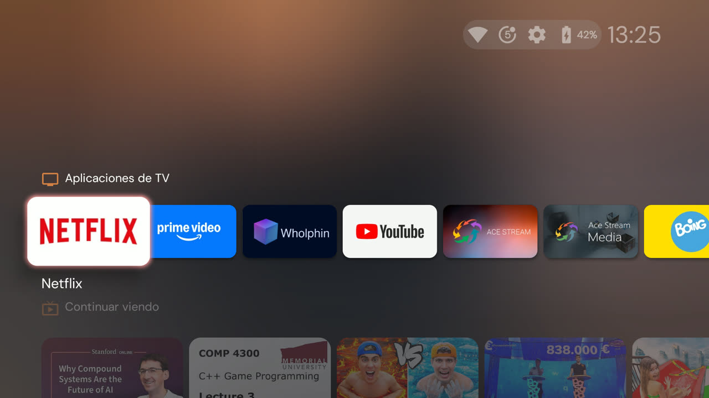
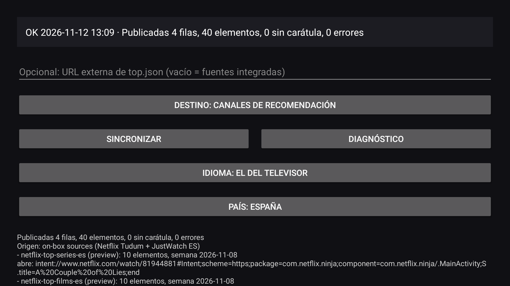

[English](README.md)

# Reconstruir un Mi Box S desde cero

Proceso repetible que lleva un **Mi Box S de primera generación (MIBOX4, Android TV 9)**
de fábrica a una pantalla de inicio limpia: publicidad, telemetría y actualizaciones de
Xiaomi desactivadas, Projectivy como lanzador y cuatro filas de Top 10 del país que elijas,
publicadas por una aplicación pequeña y propia.

## Qué hay en este repositorio

| Ruta | Qué es |
|---|---|
| `mibox-s-debloat.sh` | el debloat reversible: `check`, `list`, `apply`, `restore`, `--dry-run` |
| `README.md`, `README.es.md` | esta guía, en inglés y español, con capturas de un equipo real |
| `tests/` | la suite sin conexión que ejecuta el script contra un `adb` falso, más una comprobación de enlaces |
| `LICENSE` | MIT |

Aquí no se distribuye ningún APK: Projectivy y el feeder vienen de sus propios proyectos.

Todo esto se ejecutó en un equipo real (a Mi Box S, Android 9 / API 28) y después se
comparó con un segundo equipo ya en uso, de modo que ambos quedaron en el mismo estado.

Lo que se consigue:

| Antes | Después |
|---|---|
| Lanzador de Xiaomi con filas de promoción y el canal de PatchWall | Projectivy, solo con las filas que habilites |
| 17 paquetes alimentando publicidad, telemetría y OTA | esos mismos 17 desactivados, de forma reversible |
| Ningún Top 10 nacional en la interfaz | cuatro filas: Netflix y Prime Video, series y películas |

## Requisitos

- Un PC con `adb` y este repositorio.
- El equipo accesible en la red local. Anota su IP y ten presente el otro equipo, para no
  apuntar nunca al serial equivocado.
- Nada más: sin root, sin cuenta de Play Store y sin clave de API.

## 1. Llegar al equipo y confirmar qué es

```bash
for p in 5555 6466 8009; do nc -z -w2 <IP> $p && echo "$p open"; done
curl -s http://<IP>:8008/setup/eureka_info | head -c 200
adb connect <IP>:5555
adb devices
```

Confirma el modelo antes de tocar nada y fija el serial a partir de ahí:

```bash
adb -s <IP>:5555 shell getprop ro.product.model      # MIBOX4
adb -s <IP>:5555 shell getprop ro.build.version.sdk  # 28
adb -s <IP>:5555 shell getprop ro.serialno           # distinto del otro equipo
```

Si `adb devices` dice `unauthorized`, el diálogo RSA no se aceptó nunca: hay que
confirmarlo en el televisor, con Bugjaeger o con un cable USB. El puerto suele no
sobrevivir a un reinicio, así que termina antes de reiniciar.

## 2. Debloat reversible

```bash
ADB_SERIAL=<IP>:5555 ./mibox-s-debloat.sh check
ADB_SERIAL=<IP>:5555 ./mibox-s-debloat.sh list
ADB_SERIAL=<IP>:5555 ./mibox-s-debloat.sh apply                  # core, ads, junk
ADB_SERIAL=<IP>:5555 ./mibox-s-debloat.sh apply --tier patchwall # el lanzador con anuncios de Xiaomi
ADB_SERIAL=<IP>:5555 ./mibox-s-debloat.sh apply --tier ota       # sin más actualizaciones de firmware
```

Solo se usa `pm disable-user`, así que no se desinstala nada y todo se revierte con
`./mibox-s-debloat.sh restore`. Cada `apply` escribe antes `backups/<timestamp>/` y
comprueba cada desactivación contra el dispositivo.

Puede que el equipo ya esté parcialmente limpio. Volver a aplicar los niveles es inocuo y
es la forma más barata de demostrarlo: el informe dice `Changed 0, failed 0` y aun así
guarda un snapshot.

Si quieres PatchWall fuera en lugar de desactivado, `adb -s <IP>:5555 shell pm uninstall
--user 0 com.mitv.tvhome.atv` lo elimina para el usuario. Ese paso **no** es reversible con
`restore`: exige reinstalarlo o un reset de fábrica. Es seguro aquí porque Projectivy ya es
el inicio y el equipo siguió dibujando después de quitarlo.

## 3. Cambiar el lanzador en el orden seguro

Instala el sustituto **antes** de desactivar el de fábrica; ese orden es lo que evita
dejar el equipo sin pantalla.

```bash
adb -s <IP>:5555 install -r Projectivy.apk   # from https://github.com/spocky/miprojectivylauncher
adb -s <IP>:5555 shell am start -n com.spocky.projengmenu/.ui.home.MainActivity
adb -s <IP>:5555 exec-out screencap -p > onboarding.png   # confirmar que dibuja
ADB_SERIAL=<IP>:5555 ./mibox-s-debloat.sh apply --tier launchers
adb -s <IP>:5555 shell cmd package resolve-activity --brief -a android.intent.action.MAIN \
  -c android.intent.category.HOME   # com.spocky.projengmenu/.ui.home.MainActivity
```


Projectivy se abre en su asistente inicial; terminarlo requiere el mando.

Vuelta atrás mientras ADB siga vivo: `adb -s <IP>:5555 shell pm enable com.google.android.tvlauncher`.

Terminado el asistente, lo que el televisor muestra es el inicio de Projectivy:



## 4. Publicar las filas del ranking

La aplicación descarga los rankings en el propio equipo, así que no hacen falta servidor ni PC.

```bash
# build or download toptv-feeder.apk from the feeder's own project first
adb -s <IP>:5555 install -r toptv-feeder.apk
adb -s <IP>:5555 shell pm grant com.alberto.tvfeeder android.permission.READ_TV_LISTINGS
adb -s <IP>:5555 shell am start -n com.alberto.tvfeeder/.MainActivity
```

Deja el campo de URL **vacío**: vacío significa las fuentes propias de la app. La actividad
programa sus tareas al arrancar, y desde ahí se puede forzar una sincronización sin tocar
el mando:

```bash
adb -s <IP>:5555 shell cmd jobscheduler run -f com.alberto.tvfeeder 1
adb -s <IP>:5555 logcat -d -s TvFeeder:*
```

Informe esperado:

```
Published 4 rows, 40 items, 0 without artwork, 0 errors
Source: on-box sources (Netflix Tudum + JustWatch ES)
- netflix-top-series-es (preview): 10 items, week 2026-11-08
- netflix-top-films-es (preview): 10 items, week 2026-11-08
- prime-top-series-es (preview): 10 items
- prime-top-films-es (preview): 10 items
```



La pantalla conserva el informe que leyó al crearse: si una sincronización en segundo plano
ocurrió después, vuelve a abrir la app (`am force-stop` y luego `am start`) para ver el nuevo.

## 5. Lo que solo puede hacer una persona con el mando

1. Terminar el asistente de Projectivy y elegir un diseño.
2. Ajustes → *Categorías / Canales* → **Habilitar canales**. Sin eso Projectivy ignora las
   cuatro filas publicadas.
3. *Editar Canales*: poner Netflix, Prime Video y las cuatro filas Top por encima de las
   secciones de ajustes.
4. Abrir Prime Video una vez y elegir un perfil; si no, sus enlaces se detienen en el
   selector de perfiles.

## 6. Verificar

```bash
ADB_SERIAL=<IP>:5555 ./mibox-s-debloat.sh list          # los niveles pedidos como disabled
adb -s <IP>:5555 shell cmd package resolve-activity --brief -a android.intent.action.MAIN \
  -c android.intent.category.HOME                        # Projectivy
adb -s <IP>:5555 shell settings get secure default_input_method   # sigue siendo un teclado real
adb -s <IP>:5555 logcat -d | grep -E "FATAL EXCEPTION|ANR in"
```

Comparar dos equipos es una línea cuando ambos responden:

```bash
for d in <IP-A>:5555 <IP-B>:5555; do
  ADB_SERIAL=$d ./mibox-s-debloat.sh list | awk '{print $1,$2}' | sort > /tmp/$d.txt
done
diff /tmp/<IP-A>:5555.txt /tmp/<IP-B>:5555.txt
```

La única diferencia que importó entre los nuestros fue `com.mitv.tvhome.mitvplus`: en un
equipo estaba desinstalado y en el otro desactivado. Los dos dejan el mismo estado visible.

## Trampas que costaron tiempo real

| Síntoma | Causa | Solución |
|---|---|---|
| `failed to authenticate` | el diálogo RSA no se aceptó | aceptarlo en el televisor |
| Un segundo equipo recibe las órdenes sin avisar | dos seriales conectados | pasar siempre `--serial` / `adb -s` |
| `Could not find job 1 in package …` | las tareas se programan al abrir la actividad | abrir la app una vez y luego forzar la tarea |
| La app dice «no hay sincronización» tras una buena | la pantalla se creó antes de la ejecución en segundo plano | `am force-stop` y luego `am start` |
| Las tarjetas aparecen pero la fila está vacía | el lanzador nunca habilitó los canales de vista previa | *Habilitar canales* en Projectivy |
| Una app desaparece del inicio | `KEYCODE_MENU` sobre una tarjeta enfocada en Projectivy **la desinstala** | nunca enviar MENU ni ENTER a ciegas; solo D-pad y captura antes |
| `cmd package set-home-activity` dice `Success` y no cambia nada | API 28 lo ignora | desactivar el otro lanzador |

Nunca desactivar: `com.google.android.apps.mediashell` (Chromecast), `com.android.bluetooth`
y `com.droidlogic.ble` (el mando), `com.android.providers.tv` (el almacén de canales),
`com.google.android.gms` / `gsf` / `webview`, `com.android.tv.settings`,
`com.google.android.katniss` (voz) ni el método de entrada activo.

## Licencia

MIT.
