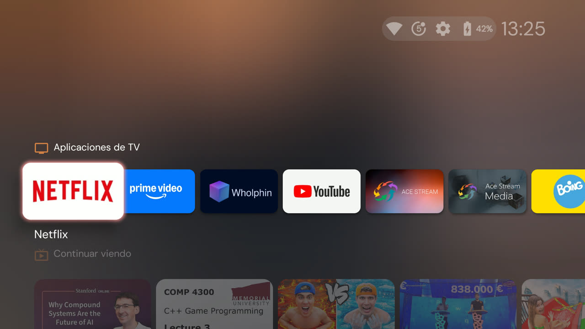
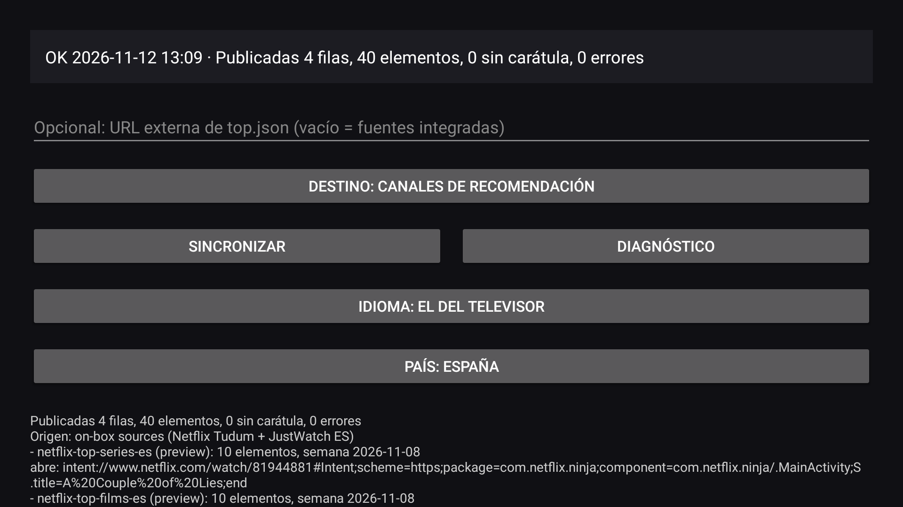

[Español](README.es.md)

# Rebuilding a Mi Box S from stock

A repeatable process that takes a stock **Mi Box S 1st gen (MIBOX4, Android TV 9)** to a
quiet home screen: Xiaomi ads, telemetry and firmware updates off, Projectivy as the
launcher, and four ranked Top 10 rows for a chosen country published by a small app of
its own.

## What is in this repository

| Path | What it is |
|---|---|
| `mibox-s-debloat.sh` | the reversible debloat: `check`, `list`, `apply`, `restore`, `--dry-run` |
| `README.md`, `README.es.md` | this guide, in English and Spanish, with screenshots from a real box |
| `tests/` | the offline suite that drives the script against a fake `adb`, plus a doc-link check |
| `LICENSE` | MIT |

No APK is distributed here: Projectivy and the feeder come from their own projects.

Everything here was executed on a real box (a Mi Box S, Android 9 / API 28) and
verified afterwards against a second box already in use, so the two ended up in the same
state.

What you get at the end:

| Before | After |
|---|---|
| Xiaomi's launcher with promo rows and a PatchWall feed | Projectivy, with only the rows you enable |
| 17 packages feeding ads, telemetry and OTA | the same 17 disabled, reversibly |
| No national Top 10 anywhere in the UI | four rows: Netflix and Prime Video, series and films |

## Prerequisites

- A PC with `adb` and this repository.
- The box reachable on the LAN. Note its IP; keep a second box in mind so you never
  target the wrong serial.
- Nothing else: no root, no Play Store account, no API key.

## 1. Reach the box and confirm what it is

```bash
for p in 5555 6466 8009; do nc -z -w2 <IP> $p && echo "$p open"; done
curl -s http://<IP>:8008/setup/eureka_info | head -c 200
adb connect <IP>:5555
adb devices
```

Confirm the model before touching anything, and always pin the serial afterwards:

```bash
adb -s <IP>:5555 shell getprop ro.product.model      # MIBOX4
adb -s <IP>:5555 shell getprop ro.build.version.sdk  # 28
adb -s <IP>:5555 shell getprop ro.serialno           # differs from the other box
```

If `adb devices` says `unauthorized`, the RSA prompt was never accepted: it has to be
confirmed on the TV, with Bugjaeger or a USB cable. The port usually does not survive a
reboot, so finish before rebooting.

## 2. Debloat, reversibly

```bash
ADB_SERIAL=<IP>:5555 ./mibox-s-debloat.sh check
ADB_SERIAL=<IP>:5555 ./mibox-s-debloat.sh list
ADB_SERIAL=<IP>:5555 ./mibox-s-debloat.sh apply                  # core, ads, junk
ADB_SERIAL=<IP>:5555 ./mibox-s-debloat.sh apply --tier patchwall # Xiaomi's ad launcher
ADB_SERIAL=<IP>:5555 ./mibox-s-debloat.sh apply --tier ota       # no more firmware pushes
```

Only `pm disable-user` is used, so nothing is uninstalled and every change is undone by
`./mibox-s-debloat.sh restore`. Every `apply` writes `backups/<timestamp>/` first and
checks each disable against the device.

The box may already be partly debloated. Running the tiers again is safe and is the
cheapest way to prove it: the run reports `Changed 0, failed 0` and still writes a
snapshot.

If you want PatchWall gone rather than disabled, `adb -s <IP>:5555 shell pm uninstall
--user 0 com.mitv.tvhome.atv` removes it for the user. That step is **not** reversible with
`restore`: it takes a reinstall or a factory reset. Safe here because Projectivy is
already the home screen and the box kept drawing after the removal.

## 3. Replace the launcher, in the safe order

Install the replacement **before** disabling the stock one; that order is what prevents
a headless box.

```bash
adb -s <IP>:5555 install -r Projectivy.apk   # from https://github.com/spocky/miprojectivylauncher
adb -s <IP>:5555 shell am start -n com.spocky.projengmenu/.ui.home.MainActivity
adb -s <IP>:5555 exec-out screencap -p > onboarding.png   # confirm it draws
ADB_SERIAL=<IP>:5555 ./mibox-s-debloat.sh apply --tier launchers
adb -s <IP>:5555 shell cmd package resolve-activity --brief -a android.intent.action.MAIN \
  -c android.intent.category.HOME   # com.spocky.projengmenu/.ui.home.MainActivity
```


Projectivy opens on its onboarding wizard; finishing it needs the remote.

Rollback while ADB is alive: `adb -s <IP>:5555 shell pm enable com.google.android.tvlauncher`.

Once the wizard is done, Projectivy's own home is what the TV shows:



## 4. Publish the ranked rows

The app fetches the rankings on the box itself, so no server and no PC are involved.

```bash
# build or download toptv-feeder.apk from the feeder's own project first
adb -s <IP>:5555 install -r toptv-feeder.apk
adb -s <IP>:5555 shell pm grant com.alberto.tvfeeder android.permission.READ_TV_LISTINGS
adb -s <IP>:5555 shell am start -n com.alberto.tvfeeder/.MainActivity
```

Leave the URL field empty: empty means the app's own sources. The activity schedules its
jobs on start, then a sync can be forced without touching the remote:

```bash
adb -s <IP>:5555 shell cmd jobscheduler run -f com.alberto.tvfeeder 1
adb -s <IP>:5555 logcat -d -s TvFeeder:*
```

Expected report:

```
Published 4 rows, 40 items, 0 without artwork, 0 errors
Source: on-box sources (Netflix Tudum + JustWatch ES)
- netflix-top-series-es (preview): 10 items, week 2026-11-08
- netflix-top-films-es (preview): 10 items, week 2026-11-08
- prime-top-series-es (preview): 10 items
- prime-top-films-es (preview): 10 items
```



The screen keeps the report it read when it was created: if a background sync happened
afterwards, reopen the app (`am force-stop` then `am start`) to see the new one.

## 5. What only a person with the remote can do

1. Finish Projectivy onboarding and pick a layout.
2. Settings → *Categorías / Canales* → **Habilitar canales**. Without it Projectivy
   ignores the four published rows.
3. *Editar Canales*: put Netflix, Prime Video and the four Top rows above the settings
   sections.
4. Open Prime Video once and pick a profile, otherwise its deep links stop at the
   profile picker.

## 6. Verify

```bash
ADB_SERIAL=<IP>:5555 ./mibox-s-debloat.sh list          # the wanted tiers as disabled
adb -s <IP>:5555 shell cmd package resolve-activity --brief -a android.intent.action.MAIN \
  -c android.intent.category.HOME                        # Projectivy
adb -s <IP>:5555 shell settings get secure default_input_method   # still a real IME
adb -s <IP>:5555 logcat -d | grep -E "FATAL EXCEPTION|ANR in"
```

Comparing two boxes is a one-liner once both are reachable:

```bash
for d in <IP-A>:5555 <IP-B>:5555; do
  ADB_SERIAL=$d ./mibox-s-debloat.sh list | awk '{print $1,$2}' | sort > /tmp/$d.txt
done
diff /tmp/<IP-A>:5555.txt /tmp/<IP-B>:5555.txt
```

The only difference that mattered between ours was `com.mitv.tvhome.mitvplus`: uninstalled
on one box, disabled on the other. Both leave the box in the same visible state.

## Traps that cost real time

| Symptom | Cause | Fix |
|---|---|---|
| `failed to authenticate` | RSA prompt never accepted | accept it on the TV |
| A second box quietly receives the commands | two serials attached | always pass `--serial` / `adb -s` |
| `Could not find job 1 in package …` | the jobs are scheduled when the activity starts | open the app once, then force the job |
| The app shows "no sync yet" right after a good sync | the screen was created before the background run | `am force-stop` then `am start` |
| Cards visible but the row is empty | the launcher never enabled preview channels | *Habilitar canales* in Projectivy |
| An app disappeared from the home screen | `KEYCODE_MENU` on a focused card in Projectivy **uninstalls it** | never send MENU or blind ENTER there; D-pad only, screenshot first |
| `cmd package set-home-activity` prints `Success` and changes nothing | API 28 ignores it | disable the other launcher instead |

Never disable: `com.google.android.apps.mediashell` (Chromecast), `com.android.bluetooth`
and `com.droidlogic.ble` (the remote), `com.android.providers.tv` (the channel store),
`com.google.android.gms` / `gsf` / `webview`, `com.android.tv.settings`,
`com.google.android.katniss` (voice), or the active input method.

## Licence

MIT.
